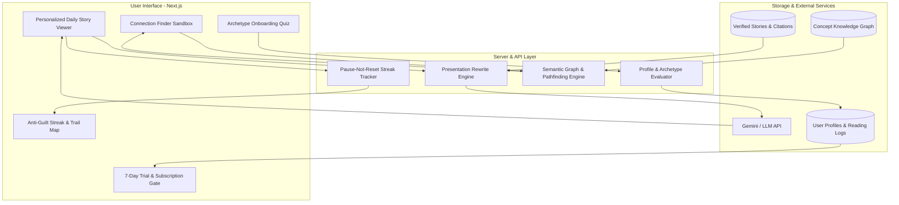

## Goal Capsule

- **Objective:** Deploy an end-to-end interactive MVP of Rabbit Trail allowing curious readers to discover their curiosity archetype, read daily sourced stories adapted to their persona, explore semantic connections between arbitrary concepts, and track their curiosity habit without streak guilt.
- **Means:** Next.js (App Router, Tailwind CSS, Lucide icons, Shadcn UI) full-stack web application with SQLite/Postgres for profiles and streaks, an LLM presentation rewriting pipeline grounded in cited sources, and a vector/graph semantic bridge engine (KTD1, KTD2, KTD3).
- **Authority Hierarchy:** Product Contract requirements (R1–R16) win over implementation choices; Key Technical Decisions (KTD1–KTD6) govern architectural mechanisms.
- **Stop Conditions:** The 6-scenario archetype quiz, automated persona-adapted story viewer, persistent Connection Finder sandbox, anti-guilt streak dashboard, and 7-day trial paywall flow are fully functional and verified via test scenarios.

---

## Product Contract

### Summary
Rabbit Trail is a daily reading application for curious adults. It replaces fragmented feeds and dry articles with one deeply sourced daily story written in the reader's distinct curiosity style, an on-demand semantic connection finder, and an anti-guilt streak tracker.

### Problem Frame
Curious people fall into rabbit holes across history, architecture, governance, and science, but existing digital tools fail them:
1. Social feeds and short-form video fragment attention, leaving readers with zero retention.
2. Wikipedia and long-form publications deliver detached facts without narrative point of view or stylistic adaptation.
3. Traditional learning apps weaponize streak guilt, making intellectual curiosity feel like homework.
Rabbit Trail anchors learning around narrative stakes, reader identity archetypes, and interconnected concept trails.

### Key Decisions
- **KD1. Automated Fact Integrity:** The pipeline uses no human editors in the loop; all factual assertions are pinned to verified, cited primary or encyclopedic sources, and the LLM adapts presentation only (`session-settled: user-directed — chosen over human editorial team: cost and scaling model at Rs 49/month`). Governs R4, R5, R6.
- **KD2. Archetype Identity & Social Sharing:** Archetypes are the primary identity and brand hook, rather than hidden preference weights (`session-settled: user-directed — chosen over cosmetic shorthand: drives virality, onboarding emotional investment, and shareability`). Governs R1, R2, R3.
- **KD3. Persistent Connection Finder:** The connection tool is an on-demand sandbox accessible anytime (`session-settled: user-directed — chosen over weekly game or static list: rewards open-ended curiosity`). Governs R7, R8, R9.
- **KD4. Micro-Subscription & 7-Day Trial:** 7-day all-inclusive free trial converting to an accessible Rs 49/month subscription (`session-settled: user-directed — chosen over freemium story caps: allows users to build a habit before payment`). Governs R13, R14.

### Requirements

#### Onboarding & Curiosity Archetypes
- R1. The app shall provide a 6-question scenario-based onboarding questionnaire evaluating reader mental models across entry style, breadth vs. depth, structure preference, and counter-argument affinity.
- R2. The system shall map quiz responses to one of 6 archetypes: The Cartographer (systems, maps, structural context), The Detective (disputes, evidence, counter-arguments first), The Archaeologist (excavation, chronological origins), The Magpie (lateral connections, surprising anecdotes), The Alchemist (transformations, principles across disciplines), or The Apprentice (foundations, clear step-by-step building).
- R3. The app shall generate a shareable visual archetype profile card with a summary of the reader's curiosity signature and key traits.

#### Daily Sourced Stories & Personalization
- R4. The app shall deliver one daily featured story centered on one person and one pivotal decision, including a genuine counter-argument section and an explicit "What We Can't Prove" boundary.
- R5. The core factual assertions of each story shall remain locked and accompanied by traceable citations and source references.
- R6. The presentation layer (headline hook, narrative framing, pacing, and explanatory analogies) shall be dynamically tailored to the user's active archetype without altering the underlying verified facts.

#### Connection Finder
- R7. The app shall allow users to input any two arbitrary words or concepts (e.g. "cheese" and "moon") and query an automated semantic bridge engine.
- R8. The connection engine shall return a verifiable multi-step path connecting concept A to concept B through historically or scientifically grounded links.
- R9. Each node in the connection path shall provide an interactive mini-story or link to relevant rabbit trails.

#### Anti-Guilt Streak & Habit Dashboard
- R10. A missed day shall pause the reader's streak and shall never reset the counter to zero.
- R11. The streak dashboard shall visualize meaningful intellectual habits: longest rabbit hole explored, curiosity radius, counter-argument exploration frequency, and favorite connections made.
- R12. The app shall render an interactive visual "Trail Map" displaying the topics and historical eras the reader has traversed over time.

#### Paywall & Monetization
- R13. First-time users shall receive an unrestricted 7-day free trial granting full access to daily stories, persona customization, and the Connection Finder.
- R14. Upon trial conclusion, access shall require a micro-subscription priced at Rs 49/month (or test billing provider equivalent).

### Scope Boundaries
- **In Scope (MVP):** Next.js web application (responsive mobile-first), simulated/pre-seeded verified story dataset, LLM persona rewriting engine, shortest-path semantic graph connection finder, local/session streak persistence, and trial paywall state machine.
- **Deferred to Follow-Up Work:** Native iOS/Android app store packaging via Capacitor, automated live web crawling of new daily breaking events, production payment gateway integration (Razorpay/Stripe webhook automation), and social reader-to-reader trail sharing.
- **Outside Product Identity:** Short-form infinite video feeds, gamified flashcards/quizzes, and algorithmic engagement bait.

---

## Planning Contract

### Key Technical Decisions
- KTD1. **Full-Stack Framework:** Build on Next.js 14+ (App Router) with TypeScript, Tailwind CSS, and Lucide React. Provides rapid full-stack prototyping with server actions, API routes, and mobile-responsive viewport.
- KTD2. **LLM Presentation Rewrite Engine:** Standardized prompt template receiving (a) verified story fact JSON with source annotations, (b) archetype profile definition, and (c) formatting constraints (counter-argument + unprovable section). The system prompt enforces strict preservation of factual claims while morphing voice, hook, and analogies.
- KTD3. **Semantic Connection Engine:** Graph-based pathfinder using a pre-indexed concept knowledge graph enriched with vector semantic search fallback to compute verifiable concept-to-concept bridges.
- KTD4. **Local & Cloud State Persistence:** Use a lightweight SQLite/PostgreSQL schema (or browser local storage + Supabase) tracking user archetype, reading logs, paused streaks, and trial expiration timestamps.
- KTD5. **Paywall State Machine:** Middleware-guarded routing checking `trial_start_date` and `subscription_status`, gracefully rendering paywall modals after day 7 without locking past reading history.

### High-Level Technical Design



---

## Implementation Units

### U1. Scaffolding, Models, and Archetype Onboarding Quiz
- **Goal:** Create application foundation, TypeScript domain types, and the 6-scenario personality quiz with shareable archetype card generation.
- **Requirements Covered:** R1, R2, R3, KD2.
- **Files Touched:**
  - `src/types/index.ts`
  - `src/data/quiz-questions.ts`
  - `src/data/archetypes.ts`
  - `src/components/quiz/QuizWizard.tsx`
  - `src/components/quiz/ArchetypeCard.tsx`
  - `src/app/onboarding/page.tsx`
- **Approach:** 
  - Define domain interfaces: `Archetype`, `QuizScenario`, `UserReadingProfile`, `Story`, `ConnectionNode`.
  - Build interactive step-by-step quiz UI with progress bar and instant scenario selection.
  - Calculate archetype scoring weights across dimensions (entry style, breadth, counter-argument priority) and display result card with copyable/shareable link.
- **Test Scenarios:**
  - Happy Path: User answers all 6 questions; system outputs correct deterministic archetype matching highest scoring profile.
  - Profile Card: User clicks share button; shareable URL/card copy correctly encodes archetype identifier.

### U2. Verified Story Store & Persona-Adapted Story Viewer
- **Goal:** Build the daily story engine with factual source locking, counter-arguments, and archetype-driven presentation switching.
- **Requirements Covered:** R4, R5, R6, KD1.
- **Files Touched:**
  - `src/data/stories.ts`
  - `src/lib/llm/prompts.ts`
  - `src/lib/llm/rewrite-engine.ts`
  - `src/app/api/stories/personalized/route.ts`
  - `src/components/story/StoryViewer.tsx`
  - `src/components/story/SourceCitations.tsx`
  - `src/app/story/[id]/page.tsx`
- **Approach:**
  - Create seed library of verified stories containing structured facts, citations, counter-arguments, and "What We Can't Prove" sections.
  - Implement LLM prompt engine that injects locked facts and instructs model to re-skin tone (e.g. Detective starts with the controversy; Cartographer starts with structural map).
  - Render story viewer with inline expandable citations, audio/reading time estimates, and style switcher for testing different archetypes.
- **Test Scenarios:**
  - Fact Preservation: Story body always retains citations and the exact locked claims regardless of active archetype.
  - Persona Adaptation: Switching active archetype from "The Detective" to "The Cartographer" re-renders hook and framing accordingly.
  - Counter-Argument: Story viewer renders counter-argument and unprovable boundary sections distinctly.

### U3. Interactive Connection Finder
- **Goal:** Implement the concept-to-concept semantic chain finder connecting two arbitrary terms with verified links.
- **Requirements Covered:** R7, R8, R9, KD3.
- **Files Touched:**
  - `src/data/concept-network.ts`
  - `src/lib/graph/pathfinder.ts`
  - `src/app/api/connections/route.ts`
  - `src/components/connections/ConnectionFinder.tsx`
  - `src/components/connections/PathGraphView.tsx`
  - `src/app/connections/page.tsx`
- **Approach:**
  - Construct a curated multi-domain bipartite/semantic graph linking concepts (e.g., Moon -> Apollo 11 -> Space Food -> Freeze-Drying -> Cheese Preservation -> Cheese).
  - Implement bidirectional Breadth-First Search (BFS) / Dijkstra pathfinder with LLM-assisted node elaboration for arbitrary user words.
  - Build animated path viewer displaying nodes, transition explanations, and expandable rabbit-hole stories.
- **Test Scenarios:**
  - Direct Path: Entering "cheese" and "moon" returns a valid chain with clear step explanations.
  - Edge Case: Entering two identical or adjacent words returns immediate 1-hop relationship gracefully.
  - Failure Handling: Unconnected terms trigger fallback narrative bridge synthesis.

### U4. Anti-Guilt Streak & Habit Dashboard
- **Goal:** Build the habit and journey visualization dashboard where missed days pause streaks without reset.
- **Requirements Covered:** R10, R11, R12.
- **Files Touched:**
  - `src/lib/habit/streak-calculator.ts`
  - `src/components/dashboard/StreakDisplay.tsx`
  - `src/components/dashboard/TrailMap.tsx`
  - `src/components/dashboard/CuriosityMetrics.tsx`
  - `src/app/dashboard/page.tsx`
- **Approach:**
  - Store reading activity logs with date stamps.
  - Calculate paused streak: consecutive reading days increment streak; missed days flag streak as `paused` rather than resetting count to 0.
  - Render visual trail map showing visited eras/domains and curiosity radar chart (e.g., curiosity radius, counter-argument ratio).
- **Test Scenarios:**
  - Paused Streak: User reads Day 1, misses Day 2, reads Day 3; streak counter shows 2 (Paused), not 1.
  - Metrics Accuracy: Ratio of completed counter-argument sections correctly increments counter-argument frequency score.

### U5. Free Trial & Micro-Subscription Paywall Flow
- **Goal:** Implement 7-day all-inclusive free trial with paywall prompt and subscription state management.
- **Requirements Covered:** R13, R14, KD4.
- **Files Touched:**
  - `src/lib/subscription/trial-manager.ts`
  - `src/components/subscription/PaywallModal.tsx`
  - `src/components/subscription/PricingCard.tsx`
  - `src/app/api/subscription/status/route.ts`
- **Approach:**
  - Store `trialStartDate` on initial onboarding completion.
  - Compute trial remaining days; if `daysElapsed <= 7`, user has unrestricted access.
  - On day 8+, render an accessible micro-subscription prompt (Rs 49/month) while preserving access to previously read stories and the user profile card.
- **Test Scenarios:**
  - Active Trial: User on Day 3 accesses all daily stories and connection finder with zero paywall blockers.
  - Expired Trial: User on Day 8 receives friendly Rs 49 subscription prompt when opening new daily story.
  - Archival Access: Expired user can still view their historical completed stories and archetype card.

---

## Verification Contract

- **Automated Tests:** Run unit and component test suites covering archetype calculation, pathfinder search, and streak pause mechanics.
  ```bash
  npm test
  ```
- **Type Safety & Build:** Ensure strict TypeScript validation and production build pass.
  ```bash
  npm run build
  ```
- **Manual Verification Gates:**
  1. Complete onboarding quiz and confirm archetype matches selected preferences.
  2. Switch archetype in story viewer and verify hook/tone changes while core facts remain identical.
  3. Query Connection Finder with test words ("cheese" & "moon") and verify chain visualizer renders.
  4. Verify missed day does not reset streak counter.

---

## Definition of Done

- All 5 Implementation Units are complete and adhere to repo-relative paths and TypeScript standards.
- All 14 Product Contract Requirements (R1–R14) have traceability in implementation units and test scenarios.
- Zero streak-reset logic exists in the codebase (streak pause verified).
- No human editorial dependency exists in the runtime pipeline; verified fact citations are present on all stories.
- Production build succeeds without errors or warnings.
